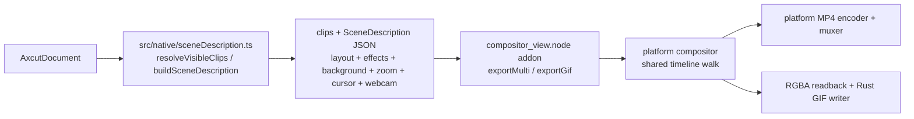

# Export pipeline

MP4 and GIF export use the same native Rust compositor and `SceneDescription` as
the live preview ([preview.md](preview.md) /
[native-compositor.md](native-compositor.md)). The renderer sends an ordered clip
list, scene JSON, and format parameters through the `compositor` IPC domain to the
napi-rs addon; a libuv worker performs the render while the renderer reports
progress. The platform implementation is selected at build time:

| Platform | Compositing and decode | MP4 encoding |
| --- | --- | --- |
| Windows | Direct3D 11; D3D11VA decode on the hardware backend, with software decode and WARP rendering when required | First usable H.264/H.265 candidate: AMF/NVENC zero-copy, QSV/Media Foundation system-frame paths, then `libopenh264`/`libkvazaar` software fallback |
| macOS | Metal; VideoToolbox decode with a software-decode upload fallback | `h264_videotoolbox`/`hevc_videotoolbox`, then `libopenh264`/`libkvazaar` software fallback |
| Linux | wgpu/Vulkan on a GPU or Mesa lavapipe, with software decode and texture upload | RGBA readback and YUV420P conversion into software `libopenh264`/`libkvazaar` |

GIF is native too. `ExportDialog` calls `exportGifNative` with the same clips and
scene used for MP4. The addon drives the shared timeline walk and platform
compositor, reads each composed RGBA frame back, then the pure-Rust GIF pipeline
quantizes it and writes GIF89a/LZW output. There is no renderer-side GIF fallback.
Performance numbers and rejected alternatives live in
[engineering/rendering-performance.md](../engineering/rendering-performance.md).



## Segment loop

The renderer calls
[`CompositorViewService.exportMulti`](../../electron/native-bridge/services/compositorViewService.ts)
for MP4 or `CompositorViewService.exportGif` for GIF. The service resolves
renderer-relative scene assets such as wallpaper images and cursor sprites, then
forwards the same clips and scene to the addon. Both tasks pause active previews,
construct one platform compositor, and drive the shared timeline walk. MP4 keeps
one encoder and muxer for the whole output; GIF keeps one Rust GIF writer.

- Per segment: load metadata and decode screen and webcam frames through the
  platform pipeline. The native walk composes each output frame as described
  below. MP4 hands the result to that platform's selected encoder and muxer.
  GIF performs `readback_direct`, palette quantization, optional dithering, and LZW output.
  Preview transport is restored when either export task finishes or fails.

- **Time projection.** The native timeline walk owns and increments one contiguous
  output frame counter. For each segment frame it computes source time as
  `segment.start_sec + segment_frame * segment.speed / out_fps`, installs that
  timeline override, then calls `compose_frame` with the running output frame
  index. `frame_geometry` uses `frame / FPS` only when no timeline override is
  present.

- **Clips are contiguous** — no gaps, no overlap. Per-clip counts produced by
  the native walk feed MP4 audio's matching integer accumulation
  (`AudioConcatPlan`).

- **MP4 audio and video junctions are seamless.** Audio is decoded per
  segment up front (`audio.rs::decode_clip_audio`), WSOLA stretches each
  speed sub-segment to its output sample count, and
  `assemble_concatenated_pcm` concatenates the per-segment PCM at the
  integer sample offsets the video loop just produced — never
  `round(cumulativeSec * sampleRate)`, because that compounds per-segment
  rounding error into audible A/V drift across a long multi-segment
  timeline. A short equal-power fade (`cos` on the tail, `sin` on the
  head, `cos² + sin² = 1`) covers each internal boundary to suppress the
  click where two recordings meet butt-joined, without shifting timing.
  The WSOLA stretch is kicked off before the video loop so it overlaps
  the encode and does not add to the wall.

- **Clip filtering and geometry hydration are separate.** `resolveVisibleClips`
  first omits timeline segments whose asset is dangling or has no non-empty
  `originalPath`. `hydrateExportDocumentDimensions` then processes only the asset
  IDs retained by that filter, reuses practical stored dimensions, and probes
  missing or invalid dimensions into an export-only document clone. A required
  probe failure blocks output sizing and scene construction rather than using an
  implicit `1920x1080` source. This is not general path validation: a retained
  stale path with already-valid stored dimensions is left for native media open
  to accept or reject. The explicit `nothingToExport` guard itself runs after
  scene JSON is built, although MP4 output sizing can reject some empty
  submissions earlier. No empty submission reaches a native export call.

- **Output** honours the timeline's selected aspect ratio
  (`resolveAspectRatioValue` over `getEditorSettings(document).aspectRatio` —
  the same typed façade `buildSceneDescription` reads, so the dialog cannot
  drift from the compositor). The hydrated, crop-aware clip dimensions feed
  [`resolveMp4ExportSettings`](../../src/lib/exporter/mp4ExportSettings.ts),
  which resolves a complete width / height / bitrate tuple before submission.
  Only "Source" quality targets source dimensions; 720p / 1080p target a fixed
  short side regardless.

## Output formats and codecs

The MP4 `exportMulti` contract requires an explicit `width` and `height`. Both
must be positive even integers, each axis must be at most `8192`, and their area
must be at most `35,389,440` pixels (`8192x4320`). The renderer client, Electron
service, and N-API boundary enforce the same limits before native allocation.

`bitrate` is optional and is expressed in bits per second. When supplied it must
be a positive safe integer no greater than `200,000,000`; the editor and CLI
normally pass the bitrate selected by the export policy. When omitted, every
platform uses the native fallback:

```text
max(2,000,000, floor(width * height * 8,000,000 / (1920 * 1080)))
```

The codec parameter accepts `"h264"` and `"h265"`, with H.264 as the omitted
default. Unsupported values such as `"vp9"` fail explicitly instead of silently
changing codecs. GIF has its own native size, frame-rate, loop, and dithering
parameters; the MP4 dimension and bitrate contract does not apply to it.

## Licensing

The app is MIT and stays MIT. Any bundled ffmpeg must be built **without**
`--enable-gpl` and without `--enable-nonfree`; those flags pull GPL or
non-redistributable components and licensing is all-or-nothing.
`scripts/fetch-ffmpeg.mjs` provisions pinned, checksum-verified Windows/Linux
artifacts, while `scripts/fetch-ffmpeg-macos.mjs` builds the pinned macOS shared
libraries from source. Both paths verify LGPL signals and fail closed. See
[native-compositor.md](native-compositor.md#build) for packaging details.

Note `ffmpeg -version` has **no** `License:` line — only `configuration:`.
The licence text is behind `-L`. An early gate looked for the former,
found nothing, and refused to vendor anything; failing closed is why that
was a bug and not an incident.

## Traps this pipeline has actually fallen into

Each cost hours and each produced a confident, wrong conclusion.

1. **`app.getGPUFeatureStatus()` from a windowless script** reports
   everything `disabled_software`. Always probe with a real window.
2. **Piping via `cat` under Git Bash** caps at ~70 MB/s — MSYS emulation,
   not Windows.
3. **`new VideoFrame(canvas)` is lazy.** Timing the constructor measures
   nothing.
4. **Isolated component benchmarks cannot price the cost of connecting
   the component.** A `node → ffmpeg` probe measured 489–589 MB/s by
   materialising frames **once**, outside the timed loop — a true
   statement about the pipe that said nothing about the pipeline.
5. **`-encoders` lists what was compiled in, not what the machine can
   run.** A portable build lists nvenc/qsv/amf everywhere; on this AMD
   laptop nvenc dies with "Cannot load nvcuda.dll". Only a one-frame
   smoke encode settles it — and the unit tests passed *because the
   fixtures encoded the same wrong assumption as the code*.
6. **Electron cannot transfer an `ArrayBuffer` renderer→main.** The
   transfer list takes `MessagePort[]`; transferring a buffer silently
   drops the whole message
   ([electron#34905](https://github.com/electron/electron/issues/34905)) —
   it works renderer→renderer.
7. **`Buffer.from(typedArray)` copies.** Wrapping
   (`Buffer.from(buf.buffer, byteOffset, byteLength)`) measured +31 %.
8. **A stale `dist-electron` bundle** runs the *previous* main process
   against the new renderer. It read as "export IPC not registered" once
   and as "the bench flag does nothing" once. The bench now refuses to
   run against one.
9. **A second instance of the same build quits silently.** The lock keys
   on the `userData` path, so another dev build already running makes a
   launch exit 0 and report nothing. The installed app
   (`openscreen.exe`) resolves a different `userData` path and does not
   conflict.

## A truncated project file is unopenable, not partially readable

`listProjects` skips a project whose JSON does not parse, so a truncated file
presents as a project that has vanished rather than as an error. Worth knowing
when a bench fixture disappears.

Two concurrent saves used to be able to produce exactly that. They no longer can:
`DocumentService` serialises saves through a per-project write queue and writes
atomically (unique temp file → `fsync` → rename) in
`electron/ai-edition/document-service.ts`.
One fixture from before the fix is still corrupt — see the Known gaps in
[../engineering/rendering-performance.md](../engineering/rendering-performance.md).

The reason that one was never repaired is the useful part: its recoverable prefix
had `speedRegions: 0, zoomRegions: 0` while the real timeline held two 3× speed
regions and a 1.80× zoom. Truncating to the valid prefix would have returned a
project that opened cleanly and was silently stripped of its effects. **A partial
document that parses is more dangerous than one that does not** — which is why the
loader rejects rather than salvages.
