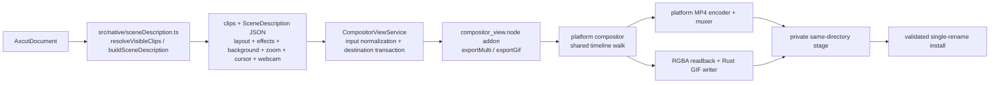

# Export pipeline

MP4 and GIF export use the same native Rust compositor and `SceneDescription` as
the live preview ([preview.md](preview.md) /
[native-compositor.md](native-compositor.md)). The renderer sends an ordered clip
list, scene JSON, format parameters, and the selected destination through the
`compositor` IPC domain. `CompositorViewService` normalizes the native inputs and
opens a destination transaction before the napi-rs addon receives a private staging
path; a libuv worker performs the render while the renderer reports progress. The
platform implementation is selected at build time:

| Platform | Compositing and decode | MP4 encoding |
| --- | --- | --- |
| Windows | Direct3D 11; D3D11VA decode on the hardware backend, with software decode and WARP rendering when required | First usable H.264/H.265 candidate: AMF/NVENC zero-copy, QSV/Media Foundation system-frame paths, then `libopenh264`/`libkvazaar` software fallback |
| macOS | Metal; VideoToolbox decode with a software-decode upload fallback | `h264_videotoolbox`/`hevc_videotoolbox`, then `libopenh264`/`libkvazaar` software fallback |
| Linux | wgpu/Vulkan on a GPU or Mesa lavapipe, with software decode and texture upload | RGBA readback and YUV420P conversion into software `libopenh264`/`libkvazaar` |

GIF is native too. `ExportDialog` calls `exportGifNative` with the same clips and
scene used for MP4. The addon drives the shared timeline walk and platform
compositor, reads each composed RGBA frame back, then the pure-Rust GIF pipeline
quantizes it and writes GIF89a/LZW output. There is no renderer-side GIF fallback.
Performance numbers and rejected alternatives live in
[engineering/rendering-performance.md](../engineering/rendering-performance.md).



## Segment loop

The renderer calls
[`CompositorViewService.exportMulti`](../../electron/native-bridge/services/compositorViewService.ts)
for MP4 or `CompositorViewService.exportGif` for GIF. The service resolves
renderer-relative scene assets such as wallpaper images and cursor sprites, then
forwards the same clips and scene to the addon. Both tasks pause active previews,
construct one platform compositor, and drive the shared timeline walk. MP4 keeps
one encoder and muxer for the whole output; GIF keeps one Rust GIF writer.

- Per segment: load metadata and decode screen and webcam frames through the
  platform pipeline. The native walk composes each output frame as described
  below. MP4 hands the result to that platform's selected encoder and muxer.
  GIF performs `readback_direct`, palette quantization, optional dithering, and LZW output.
  Preview transport is restored when either export task finishes or fails.

- **Time projection.** The native timeline walk owns and increments one contiguous
  output frame counter. For each segment frame it computes source time as
  `segment.start_sec + segment_frame * segment.speed / out_fps`, installs that
  timeline override, then calls `compose_frame` with the running output frame
  index. `frame_geometry` uses `frame / FPS` only when no timeline override is
  present.

- **Clips are contiguous** — no gaps, no overlap. Per-clip counts produced by
  the native walk feed MP4 audio's matching integer accumulation
  (`AudioConcatPlan`).

- **MP4 audio follows each clip's video, then encodes once.** The shared walk first
  composes all video frames for a clip, then calls `on_clip_end` with that clip's
  clamped source end, actual output-frame count, and speed segments. Each platform
  callback then runs `audio.rs::decode_clip_audio` for that source window and WSOLA
  stretches its speed sub-segments. Audio is therefore neither decoded up front nor
  overlapped with that clip's video encode. After the full video walk (and the
  platform's final video drain/flush), `build_audio_concat_plan` converts the actual
  per-clip frame counts to integer sample offsets and `assemble_concatenated_pcm`
  copies each clip into its slot. This never uses
  `round(cumulativeSec * sampleRate)`, which would compound per-clip rounding error
  into A/V drift. A short equal-power fade (`cos` on the tail, `sin` on the head,
  `cos² + sin² = 1`) suppresses clicks at internal boundaries without shifting
  timing, then the assembled PCM is passed to the AAC encoder once before the MP4
  trailer is written.

- **Clip filtering and geometry hydration are separate.** `resolveVisibleClips`
  first omits timeline segments whose asset is dangling or has no non-empty
  `originalPath`. `hydrateExportDocumentDimensions` then processes only the asset
  IDs retained by that filter, reuses practical stored dimensions, and probes
  missing or invalid dimensions into an export-only document clone. The editor and
  CLI resolve one ordered visible-clip list from that prepared clone and pass that
  same list to crop-aware dimension collection, aspect-ratio resolution, and
  `buildSceneDescription`; sizing cannot inspect clips that the native scene omits,
  or omit clips that native will render. A required probe failure blocks output
  sizing and scene construction rather than using an implicit `1920x1080` source.
  This is not general path validation: a retained stale path with already-valid
  stored dimensions is left for native media open to accept or reject. An empty
  retained stream is rejected before scene construction and no empty submission
  reaches a native export call.

- **Output** honours the timeline's selected aspect ratio
  (`resolveAspectRatioValue` over `getEditorSettings(document).aspectRatio` -
  the same typed facade `buildSceneDescription` reads, so the dialog cannot
  drift from the compositor). The hydrated, crop-aware dimensions of every retained
  clip feed
  [`resolveMp4ExportSettings`](../../src/lib/exporter/mp4ExportSettings.ts),
  which resolves a complete width / height / bitrate tuple before submission.
  "Source" chooses the largest frame at the selected output ratio into which every
  clip can be contain-fitted at scale at most 1, then applies the native allocation
  limits. It does not collapse a mixed-resolution or differently cropped timeline
  to one area-based representative. The fixed 720p / 1080p tiers retain their fixed
  short side and may upscale a smaller clip.

## Destination transaction

Native MP4 and GIF writers never receive the user-selected destination. Before
rendering, [`CompositorViewService`](../../electron/native-bridge/services/compositorViewService.ts)
normalizes only the local fields native can open: screen and webcam media, cursor
sidecars and sprites, image backgrounds and annotations, plus explicit post-process
inputs such as a CLI voiceover. The transaction rejects a destination that aliases
any of them by canonical path or existing-file identity. This covers relative and
`file:` spellings, case aliases on case-insensitive platforms, symlinks, and hard
links, and the check runs both before rendering and immediately before commit.

[`ExportDestinationTransactionManager`](../../electron/native-bridge/services/exportDestinationTransaction.ts)
serializes each canonical destination with in-process keys and deterministic
filesystem lock directories beside the destination. It creates a same-directory
workspace, requests private workspace/stage permissions, exclusively reserves a
single-link regular stage file with the final container extension, and rechecks the
workspace, lock, and stage identities across every state transition. Unknown stale
locks are never removed automatically, because their ownership cannot be proved.

Commit requires a non-empty, still-owned stage file. On non-Windows platforms it
copies the existing destination's POSIX permission bits to the stage, syncs and
closes the stage, verifies its path identity once more, and performs exactly one
`rename(stage, destination)`. It never moves, backs up, or unlinks the old
destination first. If the filesystem cannot perform that replacement, the rename
fails and the old destination remains at its original path. This is an atomic
installation policy, not a crash-durability guarantee: the parent directory is not
synced, and ACLs and extended attributes are not copied.

The staged MP4 path used for CLI voiceover post-processing remains inside the same
transaction. Its opaque ID is bound to one committed main-frame document owner;
navigation, renderer loss, or sender destruction revokes that owner and aborts its
transactions. The default post-process lease is five minutes and the CLI renews it
once per minute; a missed lease aborts the stage. Cleanup removes only resources
whose identities still match. If installation succeeded but cleanup remains
pending, export still reports the saved output with an `EXPORT_CLEANUP_PENDING`
warning. A lock that could not be removed remains held rather than admitting another
writer. An unknown lock left by an app-process crash blocks that destination instead
of being guessed stale; there is no automatic crash-recovery protocol.

## Output formats and codecs

The MP4 `exportMulti` contract requires an explicit `width` and `height`. Both
must be positive even integers, each axis must be at most `8192`, and their area
must be at most `35,389,440` pixels (`8192x4320`). The renderer client, Electron
service, and N-API boundary enforce the same limits before native allocation.

`bitrate` is optional and is expressed in bits per second. When supplied it must
be a positive safe integer no greater than `200,000,000`; the editor and CLI
normally pass the bitrate selected by the export policy. When omitted, every
platform uses the native fallback:

```text
max(2,000,000, floor(width * height * 8,000,000 / (1920 * 1080)))
```

The codec parameter accepts `"h264"` and `"h265"`, with H.264 as the omitted
default. Unsupported values such as `"vp9"` fail explicitly instead of silently
changing codecs. GIF has its own native size, frame-rate, loop, and dithering
parameters; the MP4 dimension and bitrate contract does not apply to it.

## Licensing

The app is MIT and stays MIT. Any bundled ffmpeg must be built **without**
`--enable-gpl` and without `--enable-nonfree`; those flags pull GPL or
non-redistributable components and licensing is all-or-nothing.
`scripts/fetch-ffmpeg.mjs` provisions pinned, checksum-verified Windows/Linux
artifacts, while `scripts/fetch-ffmpeg-macos.mjs` builds the pinned macOS shared
libraries from source. Both paths verify LGPL signals and fail closed. See
[native-compositor.md](native-compositor.md#build) for packaging details.

Note `ffmpeg -version` has **no** `License:` line — only `configuration:`.
The licence text is behind `-L`. An early gate looked for the former,
found nothing, and refused to vendor anything; failing closed is why that
was a bug and not an incident.

## Traps this pipeline has actually fallen into

Each cost hours and each produced a confident, wrong conclusion.

1. **`app.getGPUFeatureStatus()` from a windowless script** reports
   everything `disabled_software`. Always probe with a real window.
2. **Piping via `cat` under Git Bash** caps at ~70 MB/s — MSYS emulation,
   not Windows.
3. **`new VideoFrame(canvas)` is lazy.** Timing the constructor measures
   nothing.
4. **Isolated component benchmarks cannot price the cost of connecting
   the component.** A `node → ffmpeg` probe measured 489–589 MB/s by
   materialising frames **once**, outside the timed loop — a true
   statement about the pipe that said nothing about the pipeline.
5. **`-encoders` lists what was compiled in, not what the machine can
   run.** A portable build lists nvenc/qsv/amf everywhere; on this AMD
   laptop nvenc dies with "Cannot load nvcuda.dll". Only a one-frame
   smoke encode settles it — and the unit tests passed *because the
   fixtures encoded the same wrong assumption as the code*.
6. **Electron cannot transfer an `ArrayBuffer` renderer→main.** The
   transfer list takes `MessagePort[]`; transferring a buffer silently
   drops the whole message
   ([electron#34905](https://github.com/electron/electron/issues/34905)) —
   it works renderer→renderer.
7. **`Buffer.from(typedArray)` copies.** Wrapping
   (`Buffer.from(buf.buffer, byteOffset, byteLength)`) measured +31 %.
8. **A stale `dist-electron` bundle** runs the *previous* main process
   against the new renderer. It read as "export IPC not registered" once
   and as "the bench flag does nothing" once. The bench now refuses to
   run against one.
9. **A second instance of the same build quits silently.** The lock keys
   on the `userData` path, so another dev build already running makes a
   launch exit 0 and report nothing. The installed app
   (`openscreen.exe`) resolves a different `userData` path and does not
   conflict.

## A truncated project file is unopenable, not partially readable

`listProjects` skips a project whose JSON does not parse, so a truncated file
presents as a project that has vanished rather than as an error. Worth knowing
when a bench fixture disappears.

Two concurrent saves used to be able to produce exactly that. They no longer can:
`DocumentService` serialises saves through a per-project write queue and writes
atomically (unique temp file → `fsync` → rename) in
`electron/ai-edition/document-service.ts`.
One fixture from before the fix is still corrupt — see the Known gaps in
[../engineering/rendering-performance.md](../engineering/rendering-performance.md).

The reason that one was never repaired is the useful part: its recoverable prefix
had `speedRegions: 0, zoomRegions: 0` while the real timeline held two 3× speed
regions and a 1.80× zoom. Truncating to the valid prefix would have returned a
project that opened cleanly and was silently stripped of its effects. **A partial
document that parses is more dangerous than one that does not** — which is why the
loader rejects rather than salvages.
